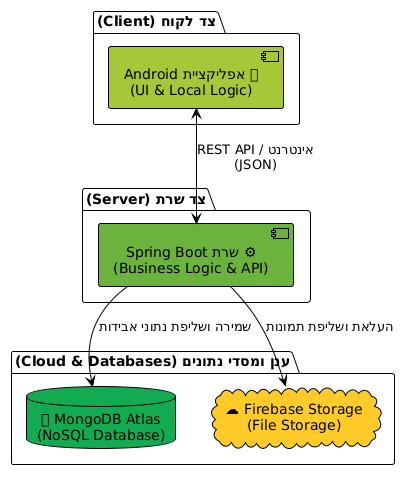
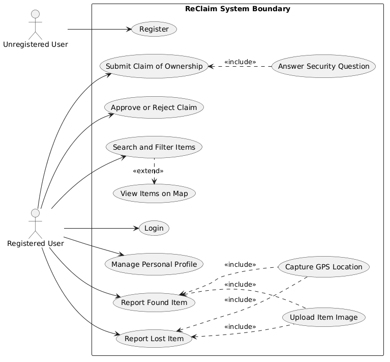
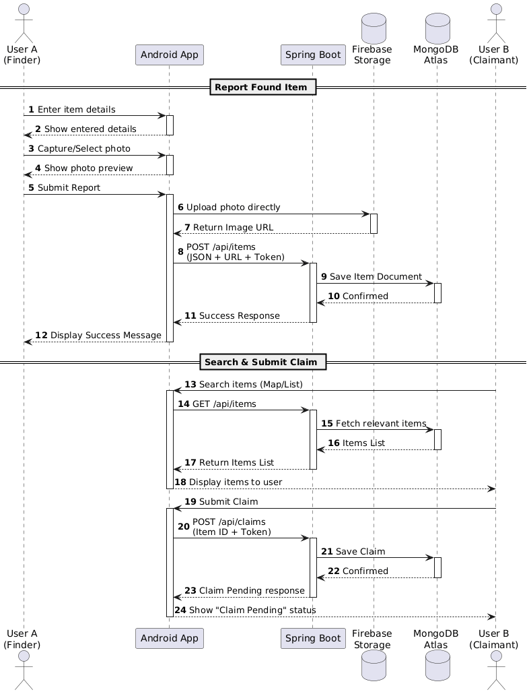
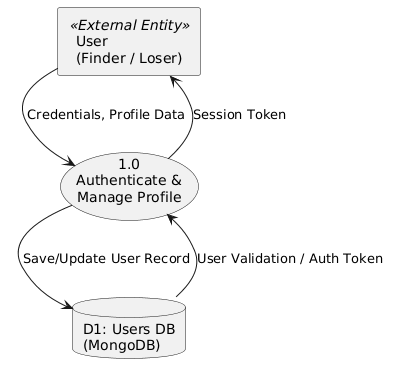
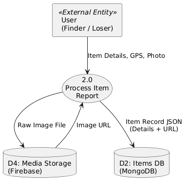
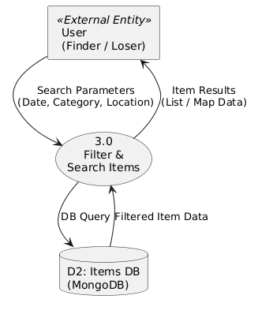
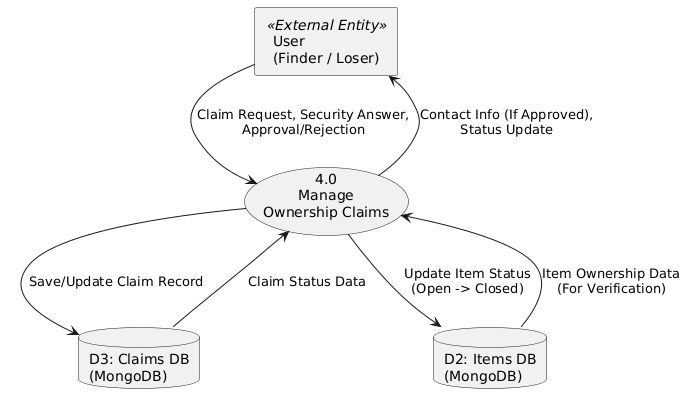

# ReClaim - Lost & Found Mobile Application

ReClaim is an advanced lost and found management system designed to connect item finders with owners through structured reporting, search, and validation processes.

---

## Table of Contents
1. [Project Overview](#1-project-overview)
2. [Background & Objectives](#2-background--objectives)
3. [Market Analysis & Limitations of Existing Solutions](#3-market-analysis--limitations-of-existing-solutions)
4. [System Architecture & Technology Stack](#4-system-architecture--technology-stack)
5. [System Modules](#5-system-modules)
6. [Core System Diagrams](#6-core-system-diagrams)
7. [Algorithmic Features & Analytics](#7-algorithmic-features--analytics)
8. [Security & Privacy](#8-security--privacy)
9. [REST API Endpoints](#9-rest-api-endpoints)
10. [Project Structure](#10-project-structure)
11. [Getting Started & Local Setup](#11-getting-started--local-setup)

---

## 1. Project Overview
Losing personal items is a common problem, and owners frequently fail to recover valuable belongings due to a lack of centralized, organized platforms. **ReClaim** provides a seamless, secure, and structured platform to bridge the gap between finders and owners of lost property.

---

## 2. Background & Objectives
* **Target Audience:** Private individuals looking to report or find lost items, as well as public institutions/entities (schools, colleges, malls, public transit) wanting to manage found property efficiently.
* **Core Value Proposition:**
  * **Streamlined Discovery:** Fast search and filtering by category, report type (Lost/Found), keyword, location, and date range—available in both **List View** and interactive **Map View**—eliminating messy, unorganized social media posts.
  * **Structured Workflows:** Every item and ownership claim features clear tracking statuses (`OPEN`/`CLOSED` for items with explicit closure reasons such as `owner found`, `owner not found`, `claim approved`, or `claim declined`; `PENDING`/`APPROVED`/`REJECTED` for claims with claimant decision acknowledgment). Finders can also submit **Private Targeted Found Reports** linked directly to an open lost report.
  * **Fraud Prevention & Permission Separation:** Only item posters can approve or reject ownership claims, preventing unauthorized access or false claims. For found items, contact details remain hidden until a claim is approved; for lost items, finders can view the reporter's contact details directly or file a targeted found report.
  * **Reliable Tracking & Offline Resilience:** Complete cloud database logging of items, claims, and core operations for accountability and data recovery, paired with an **offline report queue** on Android so users (including guests) can draft and queue reports even without an active connection.

---

## 3. Market Analysis & Limitations of Existing Solutions
Existing solutions and their shortcomings compared to ReClaim include:
* **Foundtastic:** Features AI image analysis, but relies on web interfaces (with awkward mobile home-screen links) and features a cumbersome UI.
* **Chargerback:** Offers robust security against fraud, but targets businesses and enterprises rather than private individuals.
* **iLost:** A fast, free service, but lacks user registration and fails to save data for people actively searching for lost goods.
* **Traditional Physical Storage (Lost & Found desks):** Inefficient, requires physical presence, and items frequently "fall between the cracks" without accurate digital logging.

ReClaim improves upon these alternatives by offering a dedicated Android application, immediate cloud-backed database synchronization, offline-first report queueing, real-time push notifications, robust role-based security, and a localized experience built for Israel.

---

## 4. System Architecture & Technology Stack
ReClaim utilizes an **n-tier Client-Server Architecture** deployed on the cloud with offline-capable client storage:
1. **Client Tier:** Native Android mobile application built with Material Design 3, `ViewModel`/`LiveData`, a local **Room** SQLite database for offline report queueing, and **WorkManager** for background synchronization.
2. **Server Tier:** Spring Boot REST API application running on **Render** (Dockerized) or locally via `run.sh` with optional public **ngrok** tunneling (`tunnel.sh`) and automatic client-side fallback to the local emulator host (`10.0.2.2:8080`).
3. **Database Tier:** Distributed NoSQL cloud database via **MongoDB Atlas**.
4. **File Storage Tier:** **Firebase Storage** dedicated to storing, serving, and cleaning up item photos and user profile pictures efficiently.
5. **Notifications & Messaging Tier:** **Firebase Cloud Messaging (FCM)** for real-time push notifications and **Spring Mail (SMTP)** for transactional 6-digit OTP verification and password-reset emails.

### Technologies & Languages:
* **Backend:** Java 17+ (with JDK 25 runtime support in `run.sh`), Spring Boot 3.4.1, Spring Security, Spring Data MongoDB, Spring Boot Validation, Spring Boot Mail (SMTP), JJWT (`0.12.6`), Firebase Admin SDK (`9.3.0`), Lombok, Maven, Docker.
* **Frontend (Client):** Android SDK (Java, ViewBinding, Material Design 3, `minSdk 26` / `targetSdk 36`), AndroidX Lifecycle (`ViewModel`, `LiveData`), Room (offline database), WorkManager (background sync), Google Maps SDK, Google Play Services Location, Google Places SDK (location autocomplete), Google Geocoding API, Retrofit 2 & OkHttp, Glide, Firebase Storage, Firebase Auth (anonymous session), Firebase Cloud Messaging (FCM).
* **Database & Storage:** MongoDB Atlas, Room (local SQLite queue), Firebase Storage.
* **DevOps & Version Control:** Git & GitHub, Docker, Render (`render.yaml`), Ngrok (`tunnel.sh`).

---

## 5. System Modules
* **User Management & Authentication Module:** Handles two-step user registration with **6-digit Email OTP verification** (`PendingRegistration`), secure login, **Forgot/Reset Password via Email OTP** (`PasswordResetToken`), JWT session management, profile management (updating personal details, profile picture, and password), FCM device token registration, and verified account deletion.
* **Items Management Module:** Manages the logic for publishing Lost and Found items, attaching photos and map coordinates (with Google Places autocomplete), submitting **Private Targeted Found Reports** aimed at specific open lost items, editing reports, closing reports with structured closure reasons, and executing multi-parameter searches across List and Map views.
* **Claims Module:** Oversees ownership requests on found items, verification question/answer validation, in-app claim review (`PendingClaimsSheet`), status transitions (`PENDING`/`APPROVED`/`REJECTED`), automatic closure of the item and competing pending claims upon approval, claimant decision acknowledgment, and mutual contact info unlocking once approved.
* **Storage Module:** Handles client-side image compression and uploads directly to Firebase Storage (`items/{userId}/...` and `profiles/{userId}/...`), stores image URLs inside MongoDB, and automatically deletes replaced images from Firebase Storage via the backend `FirebaseStorageService`.
* **Notifications & Messaging Module:** Sends asynchronous **Firebase Cloud Messaging (FCM)** push notifications and surfaces in-app dialogs/banners for four real-time events:
  * `ITEM_MATCH`: Notifies users when a newly posted Lost or Found report potentially matches one of their open reports.
  * `TARGETED_FOUND`: Notifies a lost-item owner when someone files a private found report specifically for their item.
  * `CLAIM_PENDING`: Alerts an item poster when a new ownership claim is waiting for review.
  * `CLAIM_DECISION`: Alerts a claimant when their claim has been approved or declined.
  * Also handles transactional SMTP emails (`EmailService`) for sign-up and password-reset OTP codes (with automatic server-log fallback when SMTP is not configured locally).
* **Offline Queue & Sync Module:** Monitors device network state (`NetworkMonitor`) and API availability (`BackendAvailability`, `OfflineProtocol`). If the device is offline or the backend is unreachable, users (including unauthenticated guests) are prompted to continue in offline report mode, saving reports locally in a **Room** database (`PendingReportStore`). Once connectivity and a valid user session return, **WorkManager** (`ReportSyncWorker`) automatically uploads queued images to Firebase Storage and submits the pending reports to the backend.

---

## 6. Core System Diagrams

### System Hierarchy Diagram


### Use Case Diagram (Users & Actions)


### Sequence Diagram (Business Logic Call Flow)


### Data Flow Diagram





---

## 7. Algorithmic Features & Analytics
* **Multi-Dimensional Querying & Indexing:** Combines case-insensitive regex text search across title, description, and location with strict categorical, report-type, temporal (`from`/`to` timestamps), and spatial filters. MongoDB B-Tree compound indexes (`MongoIndexConfig`) on `(category, status, type, reportedAt)`, `(latitude, longitude)`, and `(targetLostReportId, status)` back these queries to ensure minimal search latency without full collection scans.
* **Automated Lost & Found Matching (`ItemMatchHelper` & `ItemService`):**
  * Pairs a user's open `Lost` items with open `Found` items in the same category that were reported on or after the lost item's timestamp (`foundAt >= lostAt`).
  * Ranks candidate matches using a **Title Keyword Overlap Score** (counting shared words longer than 2 characters) and surfaces the top matches on the Home screen and via real-time `ITEM_MATCH` push notifications when new matching items are posted.
* **Geospatial Proximity Sorting (Haversine Formula):** Computes great-circle distance in kilometers between the user's location and item coordinates to power the "Nearby" feed on the Home dashboard and sort search results by proximity.
* **Statistical Insights & Analytics:**
  * *Success Rate & Closure Tracking:* Tracks `OPEN` vs. `CLOSED` item statuses along with explicit closure reasons (`owner found`, `owner not found`, `claim approved`, `claim declined`) in `ReportHistoryActivity` to measure platform utility.
  * *Hotspot Identification:* Uses geographic coordinates and Google Maps / Places / Geocoding APIs to visualize reported items on an interactive map and pinpoint high-loss public locations.

---

## 8. Security & Privacy
* **Client-Side Security:** Sensitive information (such as raw passwords) is restricted to transient RAM variables and immediately wiped after submission. JWT tokens are securely managed locally via `TokenManager`.
* **Network Security:** All production and tunnel traffic between the Android application, Spring Boot server, MongoDB Atlas, and Firebase uses encrypted **HTTPS/TLS** connections.
* **Server-Side Authorization (Spring Security):** Enforces stateless JWT authentication (`JwtAuthenticationFilter`) and strict ownership rules, ensuring users can only edit, close, delete, or review claims on items they own.
* **Database Protection & OTP Verification:** Passwords are never stored in plain text; they undergo one-way **BCrypt hashing** (`BCryptPasswordEncoder`). Account registration and password resets require a time-limited **6-digit Email OTP** with configurable expiration (`otp.expiry.minutes`, default 10 minutes) and brute-force attempt limits (`otp.max.attempts`, default 5 tries). MongoDB Atlas is restricted via credentials and network IP whitelisting.
* **Firebase Storage Security Rules (`storage.rules`):** Enforces path isolation (`items/{userId}/{fileName}` and `profiles/{userId}/{fileName}`), restricts uploads to files under **5 MB**, and blocks client-side deletions (deletions are performed exclusively by the backend via the Firebase Admin SDK).
* **Anti-Fraud & Privacy Mechanism:**
  * Finder contact details on Found reports are hidden during general browsing. Claimants must answer a verification question defined by the finder, and claims require explicit manual approval by the item poster before mutual contact details are unlocked.
  * **Private Targeted Found Reports** are hidden from public feeds and search results; only the finder who submitted the report and the owner of the target lost report are authorized to view them.

---

## 9. REST API Endpoints

### Authentication (`/api/auth` — Public)
| Method | Endpoint | Description |
| :--- | :--- | :--- |
| `POST` | `/api/auth/login` | Authenticate with email & password and receive a JWT |
| `POST` | `/api/auth/register` | Direct account creation |
| `POST` | `/api/auth/register/send-otp` | Start registration and email a 6-digit verification OTP |
| `POST` | `/api/auth/register/verify-otp` | Verify registration OTP, create the account, and return a JWT |
| `POST` | `/api/auth/register/resend-otp` | Resend a registration verification OTP |
| `POST` | `/api/auth/forgot-password/send-otp` | Send a 6-digit password reset OTP to a registered email |
| `POST` | `/api/auth/forgot-password/verify-otp` | Verify the reset OTP and issue a short-lived reset token |
| `POST` | `/api/auth/forgot-password/reset` | Set a new password using the verified reset token |

### Items (`/api/items` — Authenticated)
| Method | Endpoint | Description |
| :--- | :--- | :--- |
| `GET` | `/api/items` | Get open public items for the Home feed (excludes caller's own & closed items) |
| `GET` | `/api/items/my-items` | Get all items reported by the signed-in user |
| `GET` | `/api/items/search` | Multi-parameter search (`category`, `type`, `query`, `from`, `to`, `latitude`, `longitude`) |
| `GET` | `/api/items/category/{category}` | Get public items within a specific category |
| `GET` | `/api/items/targeted-for-me` | Get open private targeted found reports aimed at the caller's lost items |
| `GET` | `/api/items/{id}` | Get details for a specific item (if visible to the caller) |
| `GET` | `/api/items/{id}/matches` | Find open Found items that match a specific Lost item owned by the caller |
| `GET` | `/api/items/{id}/contact` | Get the reporter's contact info for a Lost item report |
| `POST` | `/api/items` | Create a new Lost, Found, or Targeted Found item report |
| `PUT` | `/api/items/{id}` | Update an existing item report (owner only) |
| `PUT` | `/api/items/{id}/close` | Close a report with a closure reason (`owner found` / `owner not found`) |
| `DELETE` | `/api/items/{id}` | Delete an item report (owner only) |

### Claims (`/api/claims` — Authenticated)
| Method | Endpoint | Description |
| :--- | :--- | :--- |
| `POST` | `/api/claims` | Submit an ownership claim with a validation answer |
| `PUT` | `/api/claims/{claimId}/review` | Approve or reject a claim (`APPROVED` / `REJECTED`, item owner only) |
| `PUT` | `/api/claims/{claimId}/acknowledge` | Mark a reviewed claim decision as seen by the claimant |
| `GET` | `/api/claims/my-claims` | List all claims submitted by the signed-in user |
| `GET` | `/api/claims/pending-on-my-items` | List pending claims awaiting review on items owned by the signed-in user |
| `GET` | `/api/claims/item/{itemId}` | List all claims associated with a specific item |
| `GET` | `/api/claims/{claimId}` | Get a single claim by ID |
| `GET` | `/api/claims/{claimId}/contact` | Get the other party's contact details for an approved claim |

### User Profile (`/api/users` — Authenticated)
| Method | Endpoint | Description |
| :--- | :--- | :--- |
| `GET` | `/api/users/me` | Get the current signed-in user's profile |
| `PUT` | `/api/users/me` | Update profile details, profile picture URL, or password |
| `PUT` | `/api/users/me/fcm-token` | Register or refresh the device's FCM push notification token |
| `DELETE` | `/api/users/me` | Permanently delete the signed-in user's account and associated data |

---

## 10. Project Structure
```text
ReClaim/
├── .env.example                 # Template for backend environment variables (MongoDB, JWT, SMTP, Firebase)
├── firebase.json                # Firebase configuration referencing storage security rules
├── storage.rules                # Firebase Storage security rules for item & profile photos
├── diagrams/                    # PlantUML sources (diagrams/plantuml/) and rendered PNGs (diagrams/png/)
├── reclaim-backend/             # Spring Boot REST API server
│   ├── Dockerfile               # Multi-stage Docker build for cloud deployment
│   ├── render.yaml              # Render cloud deployment blueprint
│   ├── pom.xml                  # Maven dependencies and build configuration
│   ├── run.sh                   # Helper script to load ../.env and start the backend
│   ├── tunnel.sh                # Helper script to expose local port 8080 via a static ngrok domain
│   └── src/
│       ├── main/java/com/example/reclaimbackend/
│       │   ├── config/          # Security, JWT filter, MongoDB, indexes, transactions, Firebase Admin
│       │   ├── controller/      # REST controllers (Auth, Item, Claim, User)
│       │   ├── dto/             # Request and response Data Transfer Objects
│       │   ├── model/           # MongoDB document models (User, Item, Claim, OTP/Reset tokens, ClosureReasons)
│       │   ├── repository/      # Spring Data MongoDB repositories
│       │   └── service/         # Business logic, email OTPs, FCM push notifications, Firebase Storage cleanup
│       └── test/                # Backend unit and security integration tests
└── reclaim-project/             # Native Android client application
    ├── local.properties.example # Template for Android SDK path & optional Maps API key fallback
    ├── secrets.properties.example # Template for GOOGLE_MAPS_API_KEY
    └── app/
        ├── google-services.json.example # Template for Firebase Android configuration
        ├── build.gradle.kts     # Android dependencies and build configuration
        └── src/main/java/com/example/reclaim/
            ├── adapter/         # RecyclerView adapters for feeds, claims, and history
            ├── data/            # Room database (ReclaimDatabase, PendingReportStore) & app state events
            ├── model/           # Client-side domain models
            ├── network/         # RetrofitClient (with local fallback), API service, JWT & TokenManager
            ├── notifications/   # FCM messaging service, token registrar, and in-app notification events
            ├── storage/         # Firebase Storage client-side image compression and upload service
            ├── sync/            # OfflineProtocol, NetworkMonitor, BackendAvailability, ReportSyncWorker
            └── ui/              # Activities & Fragments (auth, dashboard, search, report, details, myitems, profile)
```

---

## 11. Getting Started & Local Setup

### 1. Backend Setup (`reclaim-backend`)
1. Copy `.env.example` to `.env` in the repository root and fill in your credentials:
   ```bash
   cp .env.example .env
   ```
   * **Required:** `MONGODB_USER`, `MONGODB_PASSWORD`, `MONGODB_HOST`, `MONGODB_DATABASE` (or `MONGODB_URI`), and `JWT_SECRET` (at least 32 characters).
   * **Optional (Email OTPs):** `MAIL_HOST`, `MAIL_PORT`, `MAIL_USERNAME`, `MAIL_PASSWORD`. If omitted, 6-digit OTP codes are printed directly to the backend console log.
   * **Optional (Push Notifications & Storage Cleanup):** Place your Firebase service account JSON in `reclaim-backend/firebase-service-account.json` and set `FIREBASE_SERVICE_ACCOUNT=reclaim-backend/firebase-service-account.json` in `.env`.
2. Start the backend server:
   ```bash
   cd reclaim-backend
   ./run.sh
   ```
3. *(Optional)* Expose the local server over a public static ngrok domain so physical devices on any network can reach it:
   ```bash
   ./tunnel.sh
   ```

### 2. Android Client Setup (`reclaim-project`)
1. Copy `local.properties.example` to `reclaim-project/local.properties` and set your Android SDK path (`sdk.dir`).
2. Copy `secrets.properties.example` to `reclaim-project/secrets.properties` and provide a valid Google Maps / Places API key:
   ```properties
   GOOGLE_MAPS_API_KEY=your_google_maps_api_key
   ```
3. Copy `app/google-services.json.example` to `reclaim-project/app/google-services.json` and replace it with your Firebase project's `google-services.json`.
4. Open `reclaim-project` in **Android Studio**, sync Gradle, and run the `app` configuration on an emulator or physical device (Android 8.0 / API 26+).
   * `RetrofitClient` connects to the configured `BASE_URL` (ngrok tunnel) first and automatically falls back to `http://10.0.2.2:8080/` when running on the Android emulator if the tunnel is offline.